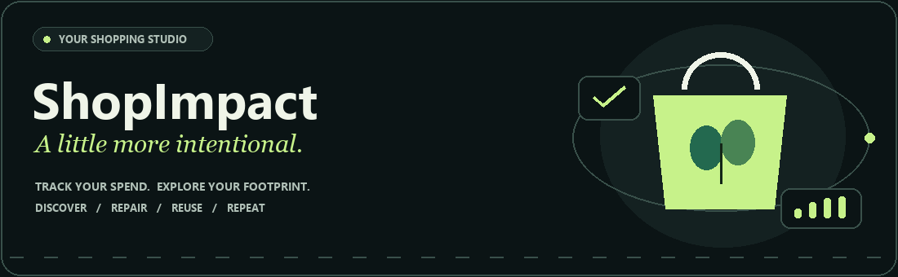

# ShopImpactAI

**Good choices. Better everyday.** A personal studio for shopping with more intention.

## New in this edition

- **Daylight & Midnight:** warm ivory and forest green, or deep ink and mint, with consistent cards, forms, tables, charts, and menus.
- **Motion with purpose:** a floating shopping-bag hero, orbital accents, a moving inspiration strip, animated milestones, progress fills, page entrances, and responsive product illustrations.
- **Your pace:** Reduce motion pauses decorative effects; your operating system's reduced-motion setting is also respected. High contrast is available under Display & accessibility.
- **Smart matches:** a local content-based recommender fits TF-IDF vectors to catalog descriptions, then ranks matches using shopping intent, category, budget, and estimated reduction. Every pick explains its reasons. Profile lets you disable purchase-history personalization. This is an explainable recommendation model, not a generative assistant or a verified environmental endorsement.
- **Consistent units:** carbon reductions use `carbon_saved_kg` and are shown in kg CO2e. They are never represented as money savings.
- **Stable backups:** version 2 preserves recorded footprint and baseline snapshots, IDs, and wishlist dates. Restoring a catalog purchase keeps its original estimate, even if category factors later change.

All commerce flows remain local demonstrations. No API key is needed.

ShopImpact is a session-based Streamlit demo for conscious shopping. It helps you record purchases, explore directional carbon-impact estimates, compare alternatives, and review spending and impact trends.

> **Demo notice:** Impact values are estimates based on broad category factors, not product-specific or independently verified lifecycle assessments. The marketplace, cart, checkout, orders, returns, and support tools are illustrative local demo flows. The app does not process payments, place real orders, contact a support team, or connect to a carrier.

## What you can do

Use the sidebar to move between these sections:

- **Overview** — See monthly spending, estimated footprint, lower-impact choices, eco score, and recent activity. Quick actions lead to common tasks.
- **Discover** — Browse and filter a curated demo catalog, inspect product details, and explore suggested picks.
- **Log a purchase** — Record a product, category, shop, price, date, and whether you chose a greener alternative. Each entry is added to your impact ledger.
- **Wishlist** — Save ideas with a category, estimated price, priority, note, and revisit date. Wishlist estimates are not included in purchase totals.
- **Cart & checkout** — Try the demo cart and checkout flow. No card details are collected and no payment or real order is submitted.
- **My orders** — Review illustrative orders created in the current session.
- **Impact analytics** — Explore summaries and charts based on the purchases in your current session.
- **Swap studio** — Compare a purchase category with suggested lower-impact alternatives and review estimated differences.
- **Eco rewards** — Review progress, badges, and challenges calculated from the session ledger.
- **Help & returns** — Try the demo return and support forms. Requests are saved only in the current session and are not sent to anyone.
- **Profile** — Set up the local demo profile; it is not a real account.

## Impact estimate

For logged purchases and CSV imports, ShopImpact calculates:

```text
estimated kg CO2e = category factor × price ÷ 10
```

The built-in factors are expressed as estimated kg CO2e per $10:

| Category | Factor | Indicative level |
|---|---:|---|
| Electronics | 3.5 | High |
| Fast fashion / leather | 2.8 | High |
| Groceries / organic food | 0.4 | Low |
| Sustainable apparel / second-hand | 0.2 | Very low |
| Beauty & personal care | 1.1 | Medium |
| Home & living | 1.5 | Medium |

These simplified factors are for exploration and comparison only. Results can vary substantially by product, materials, location, energy source, transport, and methodology; do not use them as a formal footprint report.

## Run locally

Use Python 3.10 or later.

### Windows PowerShell

```powershell
py -m venv .venv
.\.venv\Scripts\Activate.ps1
python -m pip install -r requirements.txt
python -m streamlit run ShopImpactAI.py
```

### macOS or Linux

```bash
python3 -m venv .venv
source .venv/bin/activate
python -m pip install -r requirements.txt
python -m streamlit run ShopImpactAI.py
```

Streamlit prints a local URL (usually `http://localhost:8501`) when the app starts. Stop the local server with **Ctrl+C** in the terminal.

## Dependencies

Install the project's dependencies from [`requirements.txt`](requirements.txt):

- Streamlit — app interface and session state
- pandas — purchase data handling and CSV import/export
- Plotly — interactive charts
- Pillow — reproducible animated README banner

## Import purchase history

1. Open **Log purchase** and expand **Import an existing purchase log**.
2. Select **Get CSV template** to download a header row.
3. Fill in the CSV and upload it.
4. Select **Validate and import** to add valid rows to the current session ledger.

Required columns:

| Column | Description |
|---|---|
| `product` | Non-empty product name |
| `category` | One of the exact categories listed in the impact table above |
| `price` | Finite, non-negative number |

Optional columns:

| Column | Description |
|---|---|
| `date` | ISO purchase date (`YYYY-MM-DD`); defaults to today if blank. Future dates are rejected. |
| `brand` | Brand or shop name |

Example:

```csv
date,product,category,brand,price
2026-01-15,Refill hand wash,Beauty & personal care,Ethique,18.00
2026-01-16,Second-hand reading lamp,Home & living,Etsy (vintage),35.00
```

Imports are limited to 5,000 rows at a time. Invalid rows are skipped and reported. The app recalculates impact from the submitted category and price; any supplied emissions values are not used.

## Back up and restore

In the sidebar's **Data backup** section:

- Download a JSON backup of your purchase ledger and wishlist.
- Restore a compatible ShopImpact backup after confirming that restoration replaces the current ledger and wishlist.

Backup files include those two data sets, but not the cart, profile, orders, support/return requests, or display preferences. Backups are limited to 5 MB and support up to 5,000 purchases and 500 wishlist items.

Version 2 includes recorded footprint and category-baseline snapshots. They are validated as finite, non-negative numbers and preserved during restoration. Reductions are derived from baseline minus footprint. Any invalid entry rejects the entire restore, leaving the current session unchanged.

Legacy version 1 backups are supported. Their recorded CO2 estimate is preserved when present. The old `green_savings` field mixed currencies and emissions, so it is discarded and the carbon reduction is recalculated from the saved footprint and category baseline.

## Estimates and reductions

`carbon_saved_kg = max(0, baseline_co2 - co2)`

Catalog checkout records the catalog factor's estimate and category-average baseline at the time of purchase. Selecting a greener alternative when manually logging a purchase creates an explicit lower-factor scenario, capped at 0.4 kg CO2e per $10. These comparisons are assumptions for exploration, not measured reductions. Currency is used only for prices, spending, shipping, and budgets.

## Development

The entry point delegates to focused modules in `shopimpact/`: `catalog.py`, `logic.py`, `data.py`, `recommendations.py`, `theme.py`, `ui.py`, and the individual view modules. Shared styles are in `shopimpact/assets/app.css`.

Run the regression suite:

```bash
python -m compileall -q ShopImpactAI.py shopimpact
python -m unittest discover -s tests -v
```

Tests cover impact units, lossless and legacy backups, malformed imports, recommendation ranking and privacy preferences, checkout, literal purchase search, empty states, and every page in both appearances. GitHub Actions runs these checks on Python 3.10, 3.12, and 3.14.

The README banner is a self-hosted animated GIF. Rebuild it with:

```bash
python tools/generate_banner.py
```

## Deploy on Streamlit Community Cloud

1. Push the repository to GitHub.
2. In [Streamlit Community Cloud](https://share.streamlit.io/), create an app from this repository.
3. Select the `main` branch and set **Main file path** to `ShopImpactAI.py`.
4. Deploy the app. Community Cloud installs packages from `requirements.txt`.

No Streamlit secrets are required for the current app. Do not add credentials or private data to the repository.

## Data, privacy, and limitations

- The app stores its working data in Streamlit session state; there is no database or real user account.
- Session data may be lost when the session ends or the app restarts. Download a backup if you want to keep your ledger and wishlist.
- The app does not send purchases, profile details, checkout information, or support requests to external commerce or support services.
- `.gitignore` excludes local Streamlit secrets, Python virtual environments, and Python cache files. Do not commit `.streamlit/secrets.toml`, `.venv`, `.venv-1`, or `__pycache__`.
- The app is a prototype for exploration and is not financial, environmental, or lifecycle-assessment advice.

