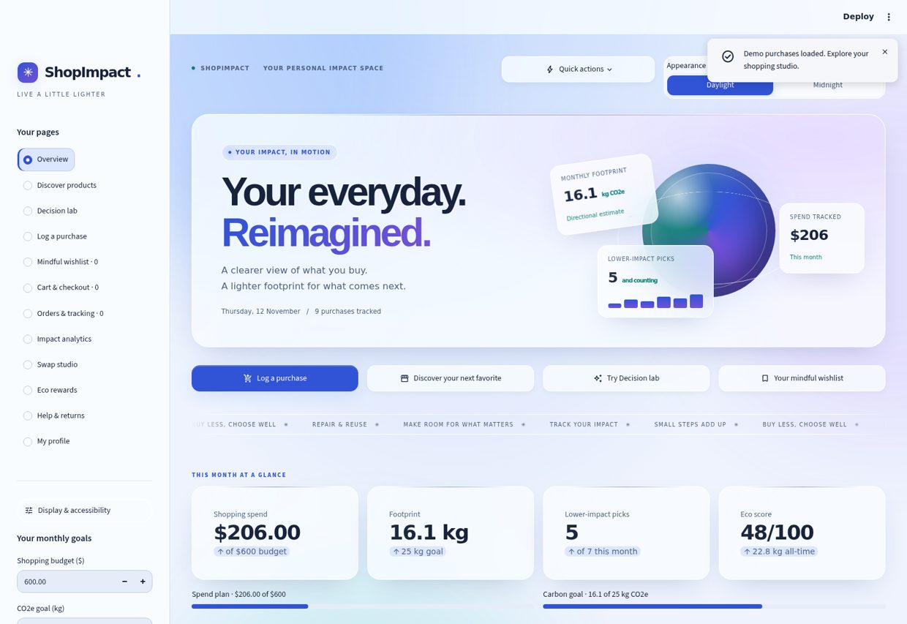
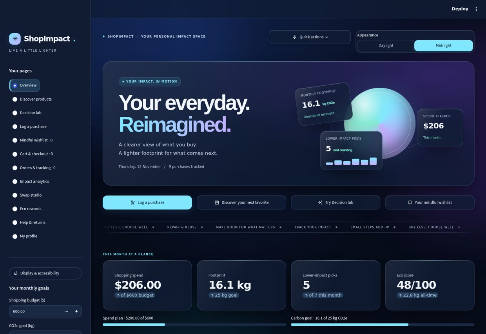
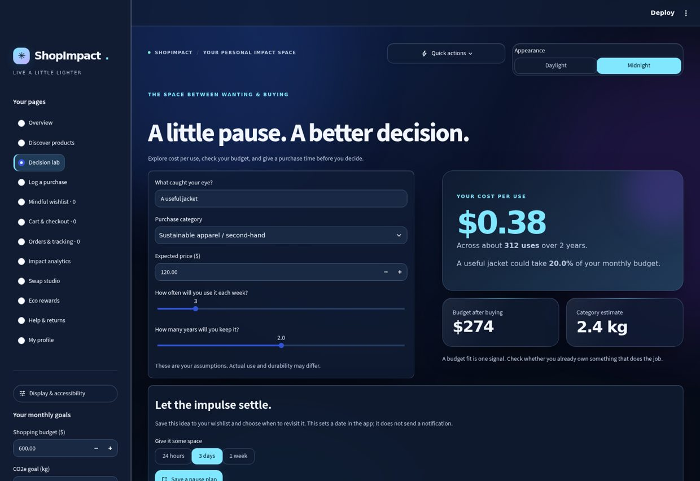

<div align="center">


# ShopImpactAI

### Your everyday. Reimagined.

A personal impact studio for the space between **wanting something** and **choosing it well**.

[](https://github.com/sritharan-blip/ShopImpactAI/actions/workflows/tests.yml)


[The experience](#the-experience) · [Run locally](#run-locally) · [How it thinks](#how-it-thinks) · [Under the glass](#under-the-glass)

</div>

---

## The experience

Track what you spend. Explore your estimated footprint. Find products that fit your intent. Take a breath before the next purchase.

<picture>
  <source media="(prefers-color-scheme: dark)" srcset="assets/screenshots/midnight-overview.jpg">
  
</picture>

<p align="center"><sub>Actual Chrome captures with the demo ledger. Daylight clarity. Midnight atmosphere.</sub></p>

<details>
<summary><strong>Explore Midnight and Decision lab</strong></summary>





</details>

| A clearer view | What you can do |
| :--- | :--- |
| **Liquid glass, two ways** | Frosted layers, moving aurora light, floating data cards, luminous edges, and a coordinated Daylight / Midnight palette. |
| **Your impact, in motion** | Follow monthly spending, category estimates, lower-impact choices, goals, and your recent activity. The hero cards use your actual session data. |
| **Smart matches** | Describe what you need. A local content model ranks the demo catalog by text similarity, category, budget, and estimated reduction, with reasons for every pick. |
| **Decision lab** | Explore cost per use and budget fit. Save a pause plan to your wishlist for tomorrow, three days, or next week. |
| **A more intentional wishlist** | Keep a shortlist, separate needs from wants, add notes, and choose a date to revisit an idea. |
| **The full shopping journey** | Explore demo products, a cart, simulated checkout, orders, returns, rewards, and analytics in one connected session. |

**Motion with an off switch.** Floating panels, orbital light, gentle card lifts, and page entrances respect your operating system's reduced-motion preference. You can also pause them under **Display & accessibility → Reduce motion**, or enable **High contrast**.

**Color changes happen together.** Text, fields, selected controls, and their backgrounds use a single active palette. The animation lives in the glass and light rather than in fading text colors.

<details>
<summary><strong>Explore all 12 spaces</strong></summary>

| Space | Inside |
| :--- | :--- |
| Overview | Monthly snapshot, goals, footprint trend, and personal activity brief |
| Discover | Search, filter, product details, and explainable smart matches |
| Decision lab | Cost per use, budget fit, and wishlist pause plans |
| Log a purchase | Purchase ledger, literal search, CSV import, and export |
| Wishlist | Need / want priorities, notes, estimated cost, and revisit dates |
| Cart & checkout | Quantities, totals, and a non-binding demo checkout |
| My orders | Illustrative session orders and tracking stages |
| Impact analytics | Category summaries, comparisons, and budget pacing |
| Swap studio | Assumed lower-factor scenarios and comparison baskets |
| Eco rewards | Milestones, progress, and weekly challenges |
| Help & returns | Local demo return and support forms |
| Profile | Session profile and purchase-history personalization preferences |

</details>

> **A prototype, with clear boundaries.** Commerce, ratings, product availability, payments, order tracking, returns, and support are demonstrations. Nothing is bought, charged, shipped, or sent to a support team. Carbon estimates are directional comparisons, not verified product lifecycle assessments.

## Run locally

Requires **Python 3.10 or later**. No API key or Streamlit secrets are needed.

<details open>
<summary><strong>Windows PowerShell</strong></summary>

```powershell
git clone https://github.com/sritharan-blip/ShopImpactAI.git
cd ShopImpactAI
py -m venv .venv
.\.venv\Scripts\Activate.ps1
python -m pip install -r requirements.txt
python -m streamlit run ShopImpactAI.py
```

If activation is restricted, run the environment's Python directly:

```powershell
.\.venv\Scripts\python.exe -m pip install -r requirements.txt
.\.venv\Scripts\python.exe -m streamlit run ShopImpactAI.py
```

</details>

<details>
<summary><strong>macOS / Linux</strong></summary>

```bash
git clone https://github.com/sritharan-blip/ShopImpactAI.git
cd ShopImpactAI
python3 -m venv .venv
source .venv/bin/activate
python -m pip install -r requirements.txt
python -m streamlit run ShopImpactAI.py
```

</details>

Open the local address printed in your terminal, usually `http://localhost:8501`. Choose **Load demo data** for a populated dashboard. Stop the server with **Ctrl+C**.

For Streamlit Community Cloud, select this repository, the `main` branch, and `ShopImpactAI.py` as the main file.

## How it thinks

### Explainable matches, without an API

The recommender fits **TF-IDF** vectors to the small built-in catalog and compares them with your shopping intent using cosine similarity. Category affinity and the catalog's estimated reduction add explicit ranking signals. A selected category and maximum budget are hard filters.

When intent is blank, recent purchase descriptions can personalize the ranking. Disable that use of history in **Profile**. A score ranks catalog items; it is not a confidence probability, an environmental certification, or a generative AI answer.

### Estimates that keep their units

```text
Category estimate (kg CO2e) = category factor × price ÷ 10
Estimated reduction (kg CO2e) = max(0, recorded baseline − recorded footprint)
Cost per use ($) = price ÷ (uses per week × 52 × years kept)
```

Catalog checkout records its demo product factor and the category-average comparison baseline at purchase time. Manually choosing a greener scenario uses an assumed factor of at most 0.4 kg CO2e per $10. Decision lab uses your own usage and lifespan assumptions. These tools make assumptions visible; they do not measure product emissions or predict durability.

<details>
<summary><strong>View the category factors</strong></summary>

| Category | Estimated kg CO2e per $10 |
| :--- | ---: |
| Electronics | 3.5 |
| Fast fashion / leather | 2.8 |
| Groceries / organic food | 0.4 |
| Sustainable apparel / second-hand | 0.2 |
| Beauty & personal care | 1.1 |
| Home & living | 1.5 |

These are broad illustrative factors. Real footprints vary with materials, manufacturing, location, transport, energy sources, and methodology. Use this app for exploration rather than formal footprint reporting.

</details>

## Your data, your copy

Working data lives in **Streamlit session state**, with no database or real account. A session ending or server restarting can clear it. Download a backup to keep your ledger and wishlist.

| Tool | What it preserves |
| :--- | :--- |
| CSV import | Required `product`, `category`, `price`; optional ISO `date` and `brand`. Emissions are recalculated from category and price. |
| JSON backup v2 | Ledger, wishlist, recorded footprints, comparison baselines, identifiers, and wishlist dates. |
| Legacy v1 restore | Recorded CO2 snapshots are retained where present. The ambiguous old `green_savings` field is discarded, and reductions are recomputed from the footprint and baseline. |

CSV imports are limited to **5 MB / 5,000 rows**; invalid rows are skipped and reported. Backups support **5 MB, 5,000 purchases, and 500 wishlist ideas**. Invalid backups reject the entire restore, leaving your current data intact. Backups exclude profile, cart, orders, support requests, and display preferences.

<details>
<summary><strong>A purchase CSV example</strong></summary>

```csv
date,product,category,brand,price
2026-01-15,Refill hand wash,Beauty & personal care,Ethique,18.00
2026-01-16,Second-hand reading lamp,Home & living,Etsy (vintage),35.00
```

Category names must match the factor table. Dates must use `YYYY-MM-DD` and cannot be in the future. Prices must be finite and non-negative. A supplied `co2` column is ignored.

</details>

Purchases and profile details are not sent to external shopping, support, or AI services. Keep credentials, virtual environments, browser profiles, and private data out of commits.

## Under the glass

| Layer | Where it lives |
| :--- | :--- |
| Entry point & navigation | `ShopImpactAI.py`, `shopimpact/app.py` |
| Glass, motion & appearance tokens | `shopimpact/theme.py`, `shopimpact/assets/app.css` |
| Reusable visual components | `shopimpact/ui.py` |
| Purchase math & catalog | `shopimpact/logic.py`, `shopimpact/catalog.py` |
| Local recommendation model | `shopimpact/recommendations.py` |
| Decision lab | `shopimpact/decisions.py` |
| Imports & snapshot backups | `shopimpact/data.py` |
| Feature views | `shopimpact/marketplace.py`, `ledger.py`, `insights.py`, `wishlist.py` |
| Reproducible animated cover | `tools/generate_banner.py` |

The interface uses Streamlit and Plotly. pandas handles ledger summaries; Pillow and NumPy generate the self-hosted animated cover. There are no external image servers or API calls behind the app's artwork.

### Checks that follow the experience

```bash
python -m compileall -q ShopImpactAI.py shopimpact
python -m unittest discover -s tests -v
```

GitHub Actions tests Python **3.10, 3.12, and 3.14**. A separate Chrome run checks real theme switches, foreground/background contrast, dropdowns, forms, mobile layout, and reduced motion, and saves screenshots as artifacts.

To run the browser checks locally, install Google Chrome and the optional test dependency:

```bash
python -m pip install playwright
python tests/browser_smoke.py
```

Rebuild the animated cover with `python tools/generate_banner.py`.

---

<div align="center">

**A little less impulse. A little more intention.**

Built by [sritharan-blip](https://github.com/sritharan-blip).

</div>
